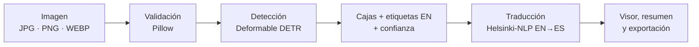

# Object Detection · Deformable DETR + traducción de etiquetas


Aplicación web de visión por computador que **detecta los objetos de una imagen** con un modelo Transformer (Deformable DETR) y **traduce sus etiquetas del inglés al español** con Helsinki-NLP. Muestra cada objeto sobre la imagen junto con su nivel de confianza.

Sube una imagen, pulsa **Analizar imagen** y revisa los resultados.

---

## Funcionalidades

- **Carga validada.** Admite arrastrar y soltar o seleccionar el archivo (JPG, JPEG, PNG o WEBP, hasta 10 MB). Antes de enviar nada se comprueba el contenido real del archivo, no solo la extensión.
- **Detección de objetos** con cajas, etiqueta y puntuación de confianza devueltas por el modelo.
- **Traducción al español** de cada etiqueta distinta, guardada en caché para no repetir peticiones.
- **Visor interactivo.** Cada clase tiene su propio color y cada objeto un identificador (`#1`, `#2`…). Al pasar el cursor, o al navegar con `Tab`, por un objeto del listado se resalta su caja en la imagen, y al revés.
- **Resumen del análisis:** total de objetos, número de clases distintas y confianza media.
- **Exportación** de la imagen anotada en PNG (a resolución original) y de las detecciones en JSON.
- **Estado de los modelos en tiempo real**, consultado en el Hub de Hugging Face.
- **Mensajes de error claros:** token no válido, sin conexión, modelo iniciándose, límite de peticiones, formato no admitido o ningún objeto detectado.
- **Diseño responsive y accesible:** dos columnas en escritorio y una en móvil, foco visible, navegación por teclado, texto alternativo en las imágenes y contraste WCAG AA.

## Cómo funciona



| Etapa | Modelo | Salida |
|---|---|---|
| Detección | [`SenseTime/deformable-detr`](https://huggingface.co/SenseTime/deformable-detr) | `box`, `label` (inglés), `score` |
| Traducción | [`Helsinki-NLP/opus-mt-en-es`](https://huggingface.co/Helsinki-NLP/opus-mt-en-es) | Etiqueta en español |

### Dos formas de ejecutar los modelos

| Backend | Dónde corre el modelo | Requiere | Ideal para |
|---|---|---|---|
| **`local`** | Dentro de la propia app, con `transformers` en CPU | `requirements-local.txt` (torch, transformers…) | **Hugging Face Spaces gratuito**, servidores propios |
| **`api`** | En la [inferencia de Hugging Face](https://huggingface.co/docs/inference-providers) | Token y créditos de Inference Providers | Desarrollo ligero sin instalar torch |

Con el valor por defecto, `INFERENCE_BACKEND=auto`, la app usa `local` si `torch` y `transformers` están instalados y `api` en caso contrario. La interfaz indica en todo momento qué backend está activo.

> [!NOTE]
> **¿Por qué ejecutar en local?** `SenseTime/deformable-detr` no tiene ningún proveedor activo en la inferencia por API: hoy solo `facebook/detr-resnet-50` y `facebook/detr-resnet-101` están disponibles por esa vía. Además, la API consume créditos (un error 402 indica que se han agotado). Con el backend `local`, **Deformable DETR se ejecuta de verdad, sin token y sin coste**. En modo `api`, la app detecta que el modelo no está disponible y usa `facebook/detr-resnet-50`, indicándolo en la interfaz.

## Demo en Hugging Face Spaces

El repositorio incluye un `Dockerfile` listo para un Space gratuito (CPU básica). Los modelos se descargan al construir la imagen, así que el Space arranca sin esperas de descarga.

```bash
pip install huggingface_hub
hf auth login                                            # token con permiso "Write"
python scripts/deploy_space.py tu-usuario/object-detection --dry-run   # revisa qué se sube
python scripts/deploy_space.py tu-usuario/object-detection
```

El script crea el Space (SDK Docker) y sube solo los archivos necesarios; nunca sube `secrets.toml`. La primera construcción tarda varios minutos. En CPU gratuita, el primer análisis tras arrancar tarda más porque carga los modelos en memoria; los siguientes llevan unos segundos.

## Puesta en marcha local

**Requisitos:** Python 3.10 o superior.

```bash
# 1. Clonar el repositorio
git clone https://github.com/santy10e/deteccion_objetos_img.git
cd deteccion_objetos_img

# 2. Crear y activar un entorno virtual
python -m venv venv
venv\Scripts\activate          # Windows
# source venv/bin/activate     # macOS / Linux
```

**Opción A: inferencia local** (sin token ni créditos; descarga unos 600 MB entre dependencias y modelos):

```bash
pip install torch --index-url https://download.pytorch.org/whl/cpu
pip install -r requirements-local.txt
streamlit run app.py
```

**Opción B: API de Hugging Face** (instalación ligera; necesita un [token](https://huggingface.co/settings/tokens) con créditos):

```bash
pip install -r requirements.txt
cp .streamlit/secrets.toml.example .streamlit/secrets.toml
# edita .streamlit/secrets.toml y pega tu token: HF_TOKEN = "hf_..."
streamlit run app.py
```

La aplicación se abre en <http://localhost:8501>.

> [!IMPORTANT]
> `.streamlit/secrets.toml` está en `.gitignore`. **No escribas el token en el código ni lo subas al repositorio.** También puedes definirlo como variable de entorno (`HF_TOKEN`).

## Configuración

Todos los ajustes se leen de `.streamlit/secrets.toml` o, si no están ahí, de variables de entorno con el mismo nombre.

| Clave | Valor por defecto | Descripción |
|---|---|---|
| `INFERENCE_BACKEND` | `auto` | `local`, `api` o `auto` (local si torch está instalado) |
| `HF_TOKEN` | — | Token de Hugging Face. **Solo necesario con el backend `api`** |
| `DETECTION_MODEL` | `SenseTime/deformable-detr` | Modelo de detección principal |
| `DETECTION_FALLBACK_MODEL` | `facebook/detr-resnet-50` | Modelo alternativo si el principal no está disponible (`none` lo desactiva) |
| `TRANSLATION_MODEL` | `Helsinki-NLP/opus-mt-en-es` | Modelo de traducción |
| `HF_INFERENCE_BASE_URL` | `https://router.huggingface.co/hf-inference/models` | Endpoint de la API (útil para un Inference Endpoint propio) |

El tema visual y el límite de subida (10 MB) se definen en [`.streamlit/config.toml`](.streamlit/config.toml).

## Estructura del proyecto

```
├── app.py                    # Punto de entrada: página, tema y navegación
├── core/                     # Lógica de negocio (sin dependencias de la UI)
│   ├── config.py             # Ajustes, backend, límites y lectura de secretos
│   ├── hf_client.py          # Backend "api": peticiones a Hugging Face y errores tipados
│   ├── local_inference.py    # Backend "local": modelos con transformers en CPU
│   ├── detection.py          # Validación de imágenes y modelos de datos
│   ├── pipeline.py           # Orquestación detección → traducción y caché
│   └── render.py             # Colores por clase, colocación de etiquetas y PNG anotado
├── ui/                       # Capa de presentación
│   ├── theme.py              # Sistema de diseño (tokens y estilos)
│   ├── icons.py              # Iconos Lucide
│   ├── components.py         # Componentes reutilizables
│   ├── detection_page.py     # Página principal y máquina de estados
│   └── models_page.py        # Pipeline, estado de los modelos y configuración
├── scripts/
│   ├── deploy_space.py       # Crea/actualiza el Space de Hugging Face
│   └── prefetch_models.py    # Descarga los modelos (usado al construir la imagen)
├── space/README.md           # Cabecera de configuración del Space
├── .streamlit/
│   ├── config.toml           # Tema y límite de subida
│   └── secrets.toml.example  # Plantilla para el token
├── Dockerfile                # Imagen para Spaces (CPU, modelos precargados)
├── requirements.txt          # Dependencias base (backend "api")
└── requirements-local.txt    # + torch y transformers (backend "local")
```

## Decisiones técnicas

- **Backends intercambiables.** `core/hf_client.py` (API) y `core/local_inference.py` (transformers) devuelven el mismo formato y lanzan las mismas excepciones tipadas (`HFAuthError`, `HFQuotaError`, `HFModelUnavailableError`…), así que la interfaz no distingue entre ellos.
- **Lógica separada de la presentación.** Ningún módulo de `core/` dibuja interfaz: la UI traduce los errores a mensajes comprensibles.
- **Flujo como máquina de estados**: `idle → ready → running → done | error`. El botón de análisis se deshabilita mientras hay una inferencia en curso, así que un doble clic no lanza peticiones duplicadas.
- **Progreso real, no simulado.** El indicador de estado se actualiza con cada paso que de verdad se ejecuta: preparar, cargar el modelo (solo la primera vez en local), detectar y traducir.
- **Modelos cargados una sola vez.** En local, cada modelo se carga en memoria una vez por proceso, con un candado para que varios usuarios simultáneos no lo carguen por duplicado.
- **Visor HTML en lugar de matplotlib.** Las cajas se posicionan en porcentaje sobre la imagen, así que escalan a cualquier tamaño de pantalla. Las etiquetas se colocan con un algoritmo sencillo que evita solapes y elige texto blanco o negro según el contraste. El PNG descargable se dibuja con Pillow a resolución original.
- **Porcentajes truncados**, no redondeados: una confianza de 0,9988 se muestra como 99,8 % y nunca como un 100 % que el modelo no ha dado.
- **Dependencias mínimas:** `streamlit`, `requests` y `Pillow` para el modo API; `torch` y `transformers` solo cuando se ejecuta en local.

## Solución de problemas

| Mensaje en la app | Causa habitual | Solución |
|---|---|---|
| *Falta el token de Hugging Face* | Backend `api` sin `HF_TOKEN` | Configura el token o usa el backend `local` |
| *Token de Hugging Face no válido* | Token caducado, revocado o sin permisos | Genera un token nuevo en <https://huggingface.co/settings/tokens> |
| *El modelo se está iniciando* | Arranque en frío del modelo en Hugging Face | Espera unos segundos y pulsa *Reintentar análisis* |
| *Créditos de Hugging Face agotados* (HTTP 402) | La cuenta consumió los créditos mensuales de Inference Providers. **No depende del modelo** | Usa el backend `local` (o el Space), compra créditos en [Billing](https://huggingface.co/settings/billing) o suscríbete a [PRO](https://huggingface.co/pro) |
| *Límite de peticiones alcanzado* | Demasiadas peticiones en poco tiempo (HTTP 429) | Espera unos segundos y reintenta |
| *Sin conexión con Hugging Face* | Sin internet o servicio caído | Comprueba la conexión y reintenta |
| *No se pudo leer la imagen* | Archivo dañado o con extensión engañosa | Usa una imagen JPG, PNG o WEBP válida |

## Tecnologías

[Python](https://www.python.org/) · [Streamlit](https://streamlit.io/) · [Transformers](https://huggingface.co/docs/transformers) · [Hugging Face Spaces](https://huggingface.co/spaces) · [PyTorch](https://pytorch.org/) · [Deformable DETR](https://arxiv.org/abs/2010.04159) · [Helsinki-NLP OPUS-MT](https://github.com/Helsinki-NLP/Opus-MT) · [Pillow](https://python-pillow.org/) · [Requests](https://requests.readthedocs.io/) · iconos [Lucide](https://lucide.dev/) (ISC)

## Contribuir

1. Haz un fork del repositorio.
2. Crea una rama: `git checkout -b mi-mejora`.
3. Haz commit de tus cambios y abre un pull request explicando qué cambia y por qué.
